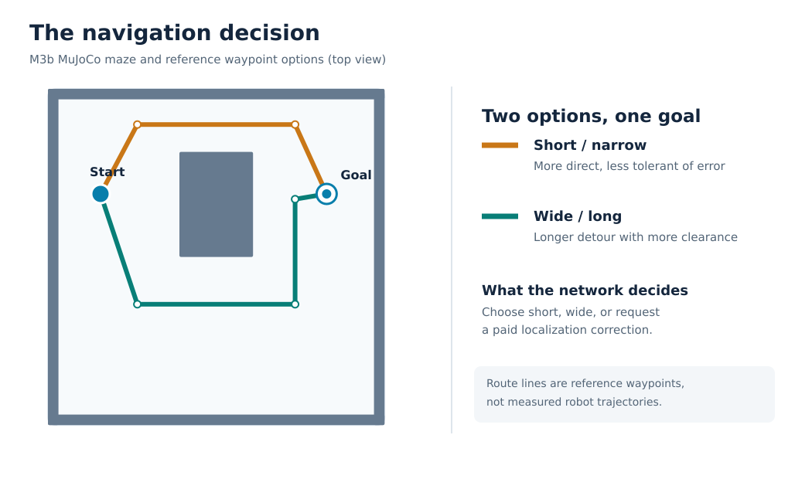
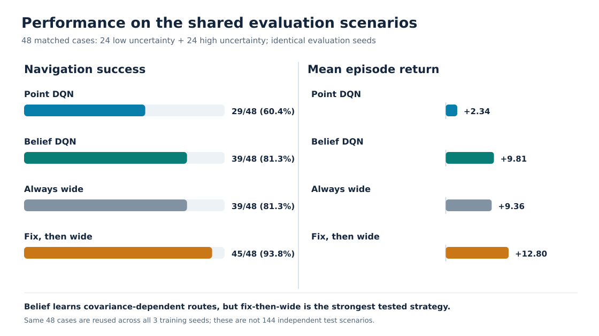
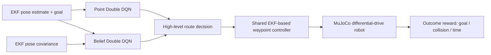
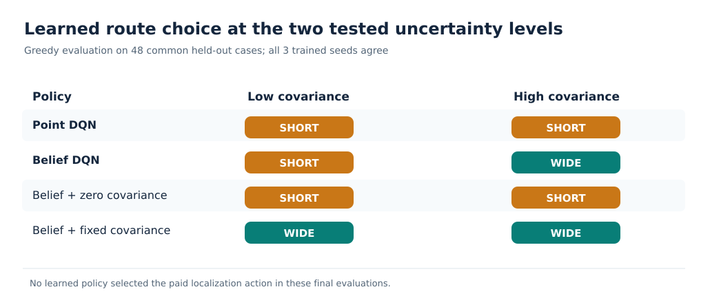

# Covariance-Aware Route Selection with Deep Reinforcement Learning

**Can localization uncertainty change the navigation decisions learned by a robot?**

A controlled **MuJoCo proof of concept** comparing two high-level Double DQN policies: **Point** (estimated goal, no covariance) and **Belief** (same information plus EKF pose covariance). Both control the same differential-drive robot through the same waypoint-following controller; **wheel commands are not learned**.



## Results at a glance

Three independently trained Point/Belief pairs converged to the same tested decision rule on **48 shared held-out scenarios** (24 low- and 24 high-uncertainty cases). These are **48 distinct scenarios, not 144 independent test situations**.



| Strategy | Successful episodes | Mean episode return |
| --- | ---: | ---: |
| Point DQN | 29/48 (60.4%) | 2.338 |
| Belief DQN | 39/48 (81.3%) | 9.815 |
| Always short | 29/48 (60.4%) | 2.338 |
| Always wide | 39/48 (81.3%) | 9.356 |
| Relocalize, then wide | 45/48 (93.8%) | 12.805 |

**Main finding:** Belief learned to choose the **short route at low uncertainty** and the **wide route at high uncertainty**. Point chose the short route in both regimes. Belief achieved 39/48 (81.3%) versus 29/48 (60.4%) for Point.

**Essential qualification:** Always-wide matched Belief's number of successes (39/48), with a slightly lower mean return (9.356 versus 9.815). **Relocalize-then-wide outperformed both learned policies** (45/48 (93.8%), mean return 12.805). This study demonstrates covariance-dependent learning, **not optimal navigation**.

## How it works



The high-level action set is **short route**, **wide route**, or **paid localization update followed by route selection**. Both networks have the same 27-input architecture: 4 goal-relative features, 16 range-input slots deliberately set to zero for both networks, 6 covariance-input slots (zero for Point), and 1 localization-available flag. The only intended information difference at the first decision is covariance. That restriction is deliberate; this experiment does **not** show that covariance beats an agent using all raw sensors.

### Learned decisions and covariance ablation



- **Training:** 240 episodes per policy per seed, with two added independent replications (6 trained models in total).
- **Evaluation:** same 48 fresh simulation scenarios for each model, seed-matched to the fixed-strategy baselines.
- **Covariance ablation:** at zero covariance, Belief falls back to short; with fixed covariance, it chooses wide, confirming the input changes its decision.
- **Active localization:** no trained policy chose the paid localization action in the final evaluations, even though it was available and the fixed relocalize-then-wide baseline was stronger.

## Repository contents

```text
src/            MuJoCo scene, EKF, shared controller, DQN and evaluation code
checkpoints/    Point and Belief policy weights for seeds 0, 1 and 2
results/        Original matched evaluation CSV/JSON and training traces
figures/        Diagrams generated from the checked-in geometry and results
scripts/        Smoke/full evaluation and figure-generation scripts
docs/           Limitations, provenance and results interpretation
```

## Verify locally

```bash
sha256sum -c SHA256SUMS.txt
bash scripts/re_evaluate.sh smoke
# Full evaluation on the saved models, no retraining:
bash scripts/re_evaluate.sh full
# Rebuild SVG figures from saved data (standard library only):
python3 scripts/build_presentation.py
```

**Environment note:** The existing reproduction launcher currently defaults to `~/belief-aware-robot-navigation/.venv/bin/python` or accepts `M7_PYTHON=/path/to/python`. A clean-clone installation and fully pinned dependencies have **not yet been validated**; see the pending publication audit. The figure generator itself uses only Python's standard library.

## Scope and limitations

This is **high-level option-selection RL**, not end-to-end navigation, autonomous route planning, or learned motor control. It uses one small maze, two prescribed uncertainty regimes, a shared fixed low-level controller, and masked high-level range inputs. EKF covariance calibration is imperfect; intermediate uncertainty levels, new maps, Gazebo transfer, and generalization are **not established**. The covariance comes from this robot's simulated EKF, not an analytical optical-tracking covariance model.

See [results interpretation](docs/PRESENTATION_RESULTS.md), [limitations](docs/LIMITATIONS.md), and [source provenance](docs/PROVENANCE.md). **No license is assigned yet pending source-provenance review.**
